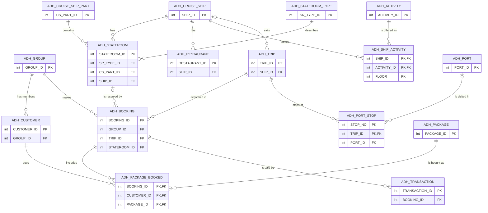

# Database Design

This document describes the cruise trip booking database: what each table
stores, how the tables relate, and the rules the database enforces. The SQL that
creates it is in [`sql/schema.sql`](../sql/schema.sql). See the
[README](../README.md) for how to set it up.

All tables are prefixed `ADH_`. Every table with a single-column ID uses
`AUTO_INCREMENT`. You can still insert explicit IDs (as the dummy data does),
and new rows get the next number.

## How It Fits Together

- A **group** is a travel party. Each **customer** belongs to one group.
- A **cruise ship** has **staterooms**, **restaurants** and **activities**.
  Each stateroom is of a **stateroom type** (size, beds, bathrooms, balconies)
  and sits in a **part** of the ship.
- A **trip** is one ship sailing between two dates. Its itinerary is a list of
  numbered **port stops**, each at a **port**.
- A group **books** a stateroom on a trip. The booking is also the invoice and
  records the nightly price at the time of booking.
- Individual customers on a booking can add **packages** (e.g. drinks, Wi-Fi),
  charged per night or per trip.
- A booking is paid through one or more **transactions**.

## Entity-Relationship Diagram

`||` means exactly one and `|o` means zero or one (the foreign key is optional).
`o{` means zero or more.

## Tables

In each table, **Key** shows the primary key (PK), unique columns, and foreign
keys (FK → the table referenced). **Rules** lists the CHECK and UNIQUE
constraints. Inserting a row that breaks a rule fails with an error naming the
constraint.

## Groups and customers

### ADH_GROUP

A travel party; bookings are made per group.

| Column | Type | Null? | Key | Description |
| --- | --- | --- | --- | --- |
| `GROUP_ID` | INT | No | PK | Group ID |

### ADH_CUSTOMER

A passenger; every customer belongs to one group.

| Column | Type | Null? | Key | Description |
| --- | --- | --- | --- | --- |
| `CUSTOMER_ID` | INT | No | PK | Passenger ID |
| `F_NAME` | VARCHAR(30) | No |  | Customer first name |
| `L_NAME` | VARCHAR(30) | No |  | Customer last name |
| `DOB` | DATE | No |  | Customer date of birth |
| `STREET` | VARCHAR(30) | No |  | Street address |
| `CITY` | VARCHAR(30) | No |  | Address city |
| `STATE` | VARCHAR(2) | No |  | Address state (2-letter code) |
| `ZIPCODE` | VARCHAR(5) | No |  | Zipcode (5 digits) |
| `COUNTRY` | VARCHAR(30) | No |  | Address country |
| `GENDER` | VARCHAR(1) | Yes |  | Gender: M, F or X (optional) |
| `NATIONALITY` | VARCHAR(30) | No |  | Customer nationality |
| `EMAIL` | VARCHAR(50) | No |  | Customer email |
| `PHONE` | VARCHAR(20) | No |  | Customer phone number |
| `GROUP_ID` | INT | No | FK → ADH_GROUP | Group ID |

**Rules:**

- First and last name can't be blank.
- Date of birth is on or after 1900-01-01.
- `STATE` is two uppercase letters (e.g. `FL`).
- `ZIPCODE` is exactly 5 digits.
- `GENDER`, if given, is `M`, `F` or `X`.
- `EMAIL` looks like `name@domain.tld` (one `@`, a dot after it, no spaces).
- `PHONE` is 7–20 characters of digits, spaces, `(`, `)`, `-` or `.`, optionally starting with `+`.

## Ships and what is on them

### ADH_CRUISE_SHIP

A cruise ship.

| Column | Type | Null? | Key | Description |
| --- | --- | --- | --- | --- |
| `SHIP_ID` | INT | No | PK | Cruise ship id |
| `SHIP_NAME` | VARCHAR(30) | No |  | Cruise ship name |
| `NO_OF_FLOORS` | SMALLINT | No |  | Number of floors in cruise ship |

**Rules:**

- Name can't be blank.
- `NO_OF_FLOORS` is 1–99.

### ADH_CRUISE_SHIP_PART

A section of a ship (e.g. forward, mid, aft) that staterooms are in.

| Column | Type | Null? | Key | Description |
| --- | --- | --- | --- | --- |
| `CS_PART_ID` | INT | No | PK | Part ID |
| `CS_PART_NAME` | VARCHAR(30) | No |  | Cruise ship part name |
| `DESCRIPTION` | VARCHAR(100) | No |  | Cruise ship part description |

**Rules:**

- Name can't be blank.

### ADH_STATEROOM_TYPE

A kind of stateroom; size and amenities shared by every room of that kind.

| Column | Type | Null? | Key | Description |
| --- | --- | --- | --- | --- |
| `SR_TYPE_ID` | INT | No | PK | Stateroom type ID |
| `SR_TYPE_NAME` | VARCHAR(30) | No | Unique | Stateroom type name |
| `SIZE` | SMALLINT | No |  | Stateroom size |
| `NO_BEDS` | SMALLINT | No |  | Bed count |
| `NO_BATHROOMS` | SMALLINT | No |  | Bathroom count |
| `BALCONY` | SMALLINT | No |  | Balcony count |

**Rules:**

- Type name is unique and can't be blank.
- `SIZE` is greater than 0.
- `NO_BEDS` and `NO_BATHROOMS` are 1–99.
- `BALCONY` is 0–99.

### ADH_STATEROOM

A bookable room on a ship.

| Column | Type | Null? | Key | Description |
| --- | --- | --- | --- | --- |
| `STATEROOM_ID` | INT | No | PK | Stateroom ID |
| `SR_TYPE_ID` | INT | No | FK → ADH_STATEROOM_TYPE | Stateroom type ID |
| `CS_PART_ID` | INT | No | FK → ADH_CRUISE_SHIP_PART | Cruise ship part id |
| `SHIP_ID` | INT | No | FK → ADH_CRUISE_SHIP | Cruise ship id |

### ADH_ACTIVITY

A kind of onboard activity (e.g. pool, casino, theater).

| Column | Type | Null? | Key | Description |
| --- | --- | --- | --- | --- |
| `ACTIVITY_ID` | INT | No | PK | Activity ID |
| `ACTIVITY_NAME` | VARCHAR(30) | No | Unique | Activity name |

**Rules:**

- Activity name is unique and can't be blank.

### ADH_SHIP_ACTIVITY

Which activities a ship has, on which floor, and how many.

| Column | Type | Null? | Key | Description |
| --- | --- | --- | --- | --- |
| `FLOOR` | SMALLINT | No | PK | Floor number |
| `NO_UNITS` | SMALLINT | No |  | Units count |
| `SHIP_ID` | INT | No | PK, FK → ADH_CRUISE_SHIP | Cruise ship ID |
| `ACTIVITY_ID` | INT | No | PK, FK → ADH_ACTIVITY | Activity ID |

**Rules:**

- `FLOOR` and `NO_UNITS` are 1–99.
- The key is ship + activity + floor, so a ship can have the same activity on several floors.

### ADH_RESTAURANT

A restaurant on a ship.

| Column | Type | Null? | Key | Description |
| --- | --- | --- | --- | --- |
| `RESTAURANT_ID` | INT | No | PK | Restaurant ID |
| `RESTAURANT_NAME` | VARCHAR(30) | No |  | Restaurant name |
| `MEAL_TYPE` | VARCHAR(30) | No |  | Meal type |
| `OPEN_TIME` | TIME | No |  | Opening time |
| `CLOSING_TIME` | TIME | No |  | Closing time |
| `FLOOR` | SMALLINT | No |  | Restaurant floor |
| `SHIP_ID` | INT | No | FK → ADH_CRUISE_SHIP | Cruise ship id |

**Rules:**

- Name and meal type can't be blank.
- `FLOOR` is 1–99.
- Opening and closing times differ. Closing earlier than opening is allowed, for places open past midnight.

## Ports and trips

### ADH_PORT

A port where trips stop.

| Column | Type | Null? | Key | Description |
| --- | --- | --- | --- | --- |
| `PORT_ID` | INT | No | PK | Port id |
| `PORT_NAME` | VARCHAR(100) | No |  | Port name |
| `STREET` | VARCHAR(150) | No |  | Port street address |
| `CITY` | VARCHAR(100) | No |  | City |
| `STATE` | VARCHAR(2) | Yes |  | Port state address (2-letter code, optional) |
| `ZIPCODE` | VARCHAR(5) | Yes |  | Numeric zipcode (5 digits, optional) |
| `COUNTRY` | VARCHAR(30) | No |  | Port country |
| `NEAREST_AIRPORT` | VARCHAR(50) | No |  | Name of nearest airport |
| `PARKING_CAPACITY` | SMALLINT | Yes |  | Parking capacity (optional) |

**Rules:**

- Name can't be blank.
- `STATE` and `ZIPCODE` are optional, for ports outside the US. If given, `STATE` is two uppercase letters and `ZIPCODE` is exactly 5 digits.
- `PARKING_CAPACITY`, if given, is 0–999.

### ADH_TRIP

A cruise: one ship sailing between two dates.

| Column | Type | Null? | Key | Description |
| --- | --- | --- | --- | --- |
| `TRIP_ID` | INT | No | PK | Trip ID |
| `START_DATE` | DATE | No |  | Start date |
| `END_DATE` | DATE | No |  | End date |
| `SHIP_ID` | INT | Yes | FK → ADH_CRUISE_SHIP | Cruise ship id |

**Rules:**

- `END_DATE` is after `START_DATE`.

### ADH_PORT_STOP

One stop on a trip itinerary, in order.

| Column | Type | Null? | Key | Description |
| --- | --- | --- | --- | --- |
| `STOP_NO` | SMALLINT | No | PK | Order of stop in trip |
| `PSTART_DATE` | DATE | No |  | Port start date |
| `PEND_DATE` | DATE | No |  | Port end date |
| `TRIP_ID` | INT | No | PK, FK → ADH_TRIP | trip id |
| `PORT_ID` | INT | Yes | FK → ADH_PORT | port id |

**Rules:**

- `STOP_NO` starts at 1.
- `PEND_DATE` is on or after `PSTART_DATE`.
- The key is stop number + trip, so each trip numbers its own stops.

## Bookings, packages and payments

### ADH_PACKAGE

An add-on package (e.g. drinks, Wi-Fi) charged per night or per trip.

| Column | Type | Null? | Key | Description |
| --- | --- | --- | --- | --- |
| `PACKAGE_ID` | INT | No | PK | Package ID |
| `PACKAGE_NAME` | VARCHAR(30) | No | Unique | Package name |
| `RATE` | DECIMAL(10,2) | No |  | Package rate |
| `RATE_TYPE` | VARCHAR(1) | No |  | Rate type if per night (N) or trip (T) |

**Rules:**

- Package name is unique and can't be blank.
- `RATE` is 0 or more.
- `RATE_TYPE` is `N` (per night) or `T` (per trip).

### ADH_BOOKING

A group's reservation of a stateroom on a trip; also the invoice.

| Column | Type | Null? | Key | Description |
| --- | --- | --- | --- | --- |
| `BOOKING_ID` | INT | No | PK | Invoice ID |
| `INVOICE_DATE` | DATE | No |  | Invoice date |
| `STATEROOM_PRICE_PER_NIGHT` | DECIMAL(8,2) | No |  | Stateroom price per night |
| `GROUP_ID` | INT | No | FK → ADH_GROUP | Group ID |
| `TRIP_ID` | INT | No | FK → ADH_TRIP | Trip ID |
| `STATEROOM_ID` | INT | Yes | FK → ADH_STATEROOM | Stateroom ID |

**Rules:**

- `STATEROOM_PRICE_PER_NIGHT` is greater than 0.

### ADH_PACKAGE_BOOKED

Which customer on a booking bought which package.

| Column | Type | Null? | Key | Description |
| --- | --- | --- | --- | --- |
| `BOOKING_ID` | INT | No | PK, FK → ADH_BOOKING | Booking id |
| `CUSTOMER_ID` | INT | No | PK, FK → ADH_CUSTOMER | Customer ID |
| `PACKAGE_ID` | INT | No | PK, FK → ADH_PACKAGE | Package ID |

**Rules:**

- A customer can have each package at most once per booking.

### ADH_TRANSACTION

A payment toward a booking; a booking can be paid in several parts.

| Column | Type | Null? | Key | Description |
| --- | --- | --- | --- | --- |
| `TRANSACTION_ID` | INT | No | PK | Transaction ID |
| `PAYMENT_DATE` | DATE | No |  | Payment date |
| `PAYMENT_AMOUNT` | DECIMAL(9,2) | No |  | Payment amount (default 0.00) |
| `PAYMENT_METHOD` | VARCHAR(30) | No |  | Payment Method |
| `BOOKING_ID` | INT | No | FK → ADH_BOOKING | Booking ID |

**Rules:**

- `PAYMENT_AMOUNT` is 0 or more and defaults to 0.
- Payment method can't be blank.

## Rules the Database Does Not Enforce

CHECK constraints can only look at one row of one table. The rules below
involve more than one table, so they are **not** enforced by the schema. The
dummy data and the API should follow them:

- A ship activity or restaurant `FLOOR` is no higher than the ship's `NO_OF_FLOORS`.
- A port stop's dates fall within its trip's `START_DATE`–`END_DATE`.
- A booked stateroom is on the same ship as the trip.
- A stateroom isn't booked twice for the same trip.
- A customer in `ADH_PACKAGE_BOOKED` belongs to the group that made the booking.

## Changes From the Original Oracle Design

- **New `ADH_STATEROOM_TYPE` table.** Size, beds, bathrooms and balconies used
  to be repeated on every stateroom row. They now live on the type, and
  `ADH_STATEROOM.SR_TYPE_ID` points to it. The old `SR_NAME` became the type's
  `SR_TYPE_NAME`.
- **Port `STATE` and `ZIPCODE` are optional** for ports outside the US.
- **`STATEROOM_PRICE_PER_NIGHT` widened** from `DECIMAL(5,2)` (max 999.99) to
  `DECIMAL(8,2)` (max 999,999.99).
- **More CHECK constraints** for formats and ranges (see each table's Rules).
- **Converted to MySQL/MariaDB.** `NUMBER` became `INT`/`SMALLINT`/`DECIMAL`
  and `VARCHAR2` became `VARCHAR`. Column comments are inline. Restaurant
  opening and closing times are `TIME` instead of `DATE`.
